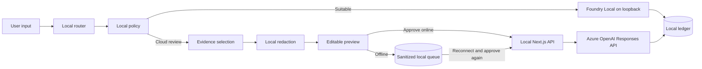

# TwelfthMan POC Architecture

## Trust Boundaries

| Boundary | Data allowed to cross |
| --- | --- |
| User to browser | Original prompt, context, sensitivity, protected terms |
| Browser to loopback `/api/local` | Original prompt and context for local-only inference |
| Browser to local queue | Sanitized evidence draft and non-content routing metadata |
| Browser to loopback `/api/cloud` | Approved `CloudEnvelope` only |
| `/api/cloud` to Azure | Canonical instruction and sanitized evidence only |
| Execution to ledger | Metrics and categories; never prompt, context, matched values, or evidence |

## Routing Contract

`localSuitability` is a pre-generation capability score, not an answer-correctness probability. It reflects task class, request size, and whether the local model is ready.

- `local`: the task fits the available local model.
- `cloud-review`: cloud reasoning may help, but nothing is sent until evidence is reviewed.
- Non-public `cloud-review`: requires local redaction and an explicit sensitive-data override.
- Offline `cloud-review`: stores a draft without send consent and becomes `ready-for-review` after reconnection.

## Cloud Contract

The cloud API rejects unknown fields, raw `prompt` or `context`, missing consent, oversized evidence, and residual structured identifiers. The Azure request uses `/openai/v1/responses`, `store: false`, and `max_output_tokens: 450`. The local server authenticates with a Microsoft Entra token scoped to `https://ai.azure.com/.default`; API-key authentication is an optional fallback.

## Failure Behavior

| Failure | Behavior |
| --- | --- |
| Foundry Local unavailable | Local runtime shown as unavailable; no simulated answer |
| Model not cached or loaded | Preflight fails until the CLI prepares the model |
| Network unavailable | Local work continues; cloud drafts may be queued |
| Azure not configured | Cloud route returns a visible configuration error |
| Azure guardrail blocks | UI reports a guardrail rejection |
| Azure throttles | UI reports capacity and retains queued work |
| Azure times out or fails | No synthetic answer and no completed ledger entry |

## POC Limitations

The deterministic redactor covers a declared set of English and US patterns plus configured protected terms. It does not prove that all sensitive information has been detected. Human review is part of the outbound security control.

Foundry Local and the selected model must be loaded before the exhibit. The loopback-only adapter prevents configuration from redirecting raw local content to a remote host.